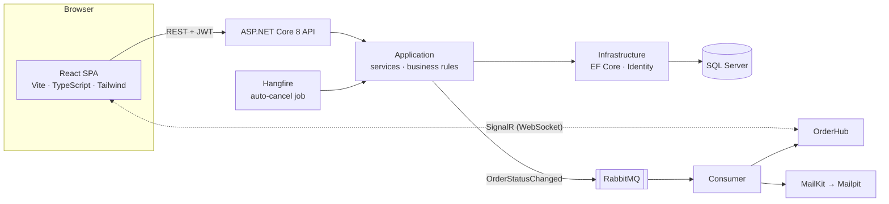

# FulfillmentPlatform

**A multi-tenant marketplace with live order tracking.** Customers shop from several independent shops in one cart; each shop fulfils its own part; everyone sees every status change in real time.

Built with **ASP.NET Core 8**, **EF Core**, **SignalR**, **RabbitMQ**, **Hangfire** and a **React + TypeScript** frontend.


> 🇩🇪 **Kurz auf Deutsch:** Ein mandantenfähiger Marktplatz: Kunden kaufen bei mehreren Shops in einem Warenkorb, beim Checkout wird pro Shop eine Bestellung angelegt (in einer Transaktion), und Statusänderungen erscheinen live über RabbitMQ und SignalR. Backend mit Clean Architecture, 30 automatisierte Tests, Frontend auf Deutsch und Englisch.

---

## ✨ Features

### For customers

- **Marketplace** across all shops: search, categories, sorting, paging (filters live in the URL, so links are shareable)
- **Shop pages** with their own branding (`/shop/modehaus`)
- **One cart for many shops**, grouped by seller
- **Checkout split:** one cart → one order per shop, saved in **one transaction** (all or nothing)
- **My orders** with a progress bar, history and **live updates** (no page reload)
- Order confirmation and status **emails**
- **German / English**, **dark mode**, works on **mobile**

### For shop admins (tenants)

- **Dashboard:** revenue (14 days), orders, average order value, cancellation rate, low stock, live updates
- **Order board (Kanban):** drag & drop to change the status, with optimistic updates and rollback; forbidden moves are rejected
- **Products:** create, edit, hide (products are hidden instead of deleted, because old orders still reference them)
- Every admin sees **only their own shop's data**

### Behind the scenes

- **Hangfire** job cancels orders that stay _Pending_ for 3 days and returns the stock
- **Optimistic concurrency** (`RowVersion`) protects the stock when two customers buy the last item

---

## 📸 Screenshots

| Marketplace                              | Shop page                         |
| ---------------------------------------- | --------------------------------- |
|  |  |

| Cart split by shop                | My orders (live)                    |
| --------------------------------- | ----------------------------------- |
|  |  |

| Admin dashboard                        | Order board (drag & drop)          |
| -------------------------------------- | ---------------------------------- |
|  |  |

| Mobile                              | Dark mode                         |
| ----------------------------------- | --------------------------------- |
|  |  |

---

## 🏗️ Architecture



**Backend: Clean Architecture**

| Project                              | Responsibility                                                                                                                              |
| ------------------------------------ | ------------------------------------------------------------------------------------------------------------------------------------------- |
| `FulfillmentPlatform.Domain`         | entities, enums, the order status state machine — no dependencies                                                                           |
| `FulfillmentPlatform.Application`    | services, DTOs, validation, interfaces (`IAppDbContext`, `ICurrentUserService`, `IEventPublisher` …) — independent of the database provider |
| `FulfillmentPlatform.Infrastructure` | EF Core, migrations, Identity + JWT, RabbitMQ, email, seeding                                                                               |
| `FulfillmentPlatform.Api`            | controllers, SignalR hub, authentication, exception handling, Hangfire                                                                      |

**Frontend**

| Folder                                 | Content                                                              |
| -------------------------------------- | -------------------------------------------------------------------- |
| `src/pages`                            | one component per page (customer + `admin/`)                         |
| `src/layouts`                          | customer top bar and admin sidebar (`<Outlet />`)                    |
| `src/auth`, `src/cart`, `src/realtime` | React contexts: login state, cart, SignalR connection                |
| `src/lib`                              | typed API client, formatting (prices in `de-DE`), helpers            |
| `src/components`                       | reusable UI (product card, status badge, catalog browser, shadcn/ui) |

---

## 🧠 Key design decisions

| Decision                                                         | Why                                                                                                                          |
| ---------------------------------------------------------------- | ---------------------------------------------------------------------------------------------------------------------------- |
| **Customers are platform accounts, admins belong to one tenant** | one login for all shops, like a real marketplace; admins stay isolated                                                       |
| **Global query filters** for tenant isolation                    | the rule can't be forgotten in a new query: an admin of shop A gets **404** for shop B's data (covered by integration tests) |
| **Checkout split in one `SaveChanges`**                          | one transaction: either every shop's order is saved, or none                                                                 |
| **Tenant comes from the product, never from the request**        | a client can't place an order "for" another shop                                                                             |
| **Public catalog DTO**                                           | no SKU, no tenant id, no exact stock — stock is shown as "only 3 left"                                                       |
| **Events via RabbitMQ, push via SignalR**                        | the API stays fast; email and live updates happen asynchronously, with ACK/NACK                                              |
| **Optimistic updates in the Kanban board**                       | instant UI; rollback if the API rejects the move; the backend still enforces the state machine                               |
| **Secrets in User Secrets, fail fast at startup**                | no keys in the repository                                                                                                    |

---

## 🧰 Tech stack

**Backend:** .NET 8 · ASP.NET Core Web API · EF Core (SQL Server) · ASP.NET Core Identity + JWT · SignalR · RabbitMQ · Hangfire · MailKit · Serilog · xUnit · Moq · WebApplicationFactory

**Frontend:** React · TypeScript · Vite · Tailwind CSS · shadcn/ui (Radix) · TanStack Query · React Router · react-i18next · @microsoft/signalr · Recharts · dnd-kit · sonner

**Dev tools:** Docker (RabbitMQ, Mailpit) · Swagger · ESLint

---

## 🚀 Run it locally

### Prerequisites

- .NET 8 SDK
- Node.js 20+
- Docker Desktop
- SQL Server LocalDB (comes with Visual Studio)
- EF Core CLI: `dotnet tool install --global dotnet-ef`

### 1. Start RabbitMQ and Mailpit

```bash
docker run -d --name rabbitmq -p 5672:5672 -p 15672:15672 rabbitmq:3-management
docker run -d --name mailpit -p 1025:1025 -p 8025:8025 axllent/mailpit
```

### 2. Set the JWT secret (stored outside the repository)

```bash
dotnet user-secrets set "Jwt:Key" "<any random string with at least 32 characters>" --project src/FulfillmentPlatform.Api
```

### 3. Create the database

```bash
dotnet ef database update --project src/FulfillmentPlatform.Infrastructure --startup-project src/FulfillmentPlatform.Api
```

### 4. Start the API

```bash
dotnet run --project src/FulfillmentPlatform.Api
```

In development, demo data (3 shops, users, 18 products) is created automatically.

### 5. Start the frontend

```bash
cd frontend
npm install
npm run dev
```

### Open

|                  | URL                                    |
| ---------------- | -------------------------------------- |
| App              | http://localhost:5173                  |
| Swagger          | https://localhost:7172/swagger         |
| Mailpit (emails) | http://localhost:8025                  |
| RabbitMQ         | http://localhost:15672 (guest / guest) |
| Hangfire         | https://localhost:7172/hangfire        |

### Demo accounts (password: `Passwort1`)

| Role                      | Email                         |
| ------------------------- | ----------------------------- |
| Customer                  | `anna@test.de`, `ben@test.de` |
| Admin ModeHaus (fashion)  | `max@modehaus.de`             |
| Admin SchuhWerk (shoes)   | `admin@schuhwerk.de`          |
| Admin GlowLab (cosmetics) | `admin@glowlab.de`            |

**Try the live demo:** log in as Anna in one window and as Max in an incognito window. Anna orders → Max sees the new order on the board → Max drags it to _Shipped_ → Anna's "My orders" updates instantly.

---

## ✅ Tests

```bash
dotnet test
```

**30 tests**, unit and integration, including:

- checkout splits a cart from two shops into two orders with the same `CheckoutId`
- **all or nothing:** if one item is out of stock, no order is saved and no stock changes
- an admin of shop A gets **404** for an order of shop B
- customers get **403** on admin endpoints; visitors get **401**
- the public catalog never exposes SKU, tenant id or exact stock

Frontend checks:

```bash
cd frontend
npm run lint
npm run build
```

---

## 🗺️ Roadmap

- Docker Compose for the whole stack (one command)
- GitHub Actions CI (tests on every push)
- Deployment to Azure
- Product variants (size, colour) and product images
- PDF invoices

---

## 👩‍💻 Author

**Nagmani Mudgundi** — Full-Stack .NET Developer, Reutlingen
[GitHub](https://github.com/NagmaniMudgundi) · LinkedIn: (https://www.linkedin.com/in/nagmani-mudgundi/)
